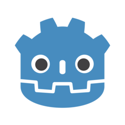
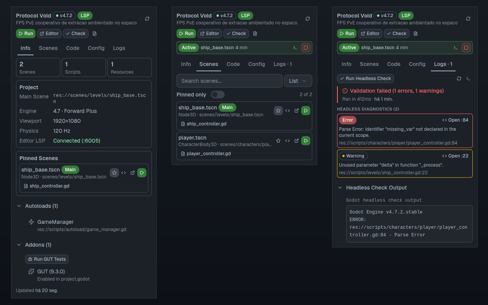

# Godot Companion — Orca IDE Plugin

Sidebar panel and trusted-worker integration for **Godot Engine** (3.x / 4.x) inside [Orca IDE](https://orca.stably.ai).

> Complements Orca's official `stablyai.orca-godot` syntax-highlighting plugin with live project inspection, scene launching, headless validation, export presets, and terminal log diagnostics.



## Features

- **Project Overview**: Auto-detects `project.godot` (including monorepos with multiple Godot projects), parses engine features, renderer, viewport size, physics tick rate, autoload singletons, addons, and probes Godot Editor LSP port (`6005` by default).
- **One-Click Execution & Shortcuts**:
  - **Run (`Ctrl+F5` / `Cmd+F5`)** main scene or **Run Scene** on any `.tscn` inside a managed Orca terminal.
  - **Stop (`Ctrl+F8` / `Cmd+F8`)** active run, **Headless Check (`Ctrl+Shift+F5` / `Cmd+Shift+F5`)**, and **Open in Godot Editor (`Ctrl+Alt+G` / `Cmd+Alt+G`)**.
  - **Active Session Bar** with elapsed time, Focus Terminal, and Stop controls.
- **Scene Explorer (List & Tree views)**: Search scenes by name, `res://` path, root node type (`CharacterBody3D`, `Node3D`, `Control`, ...), or attached script; star/pin favorite scenes per project for instant launch.
- **Scripts, Shaders & Resources**: Sortable and filterable table of `.gd`, `.cs`, `.gdshader`, and `.tres` files showing `class_name`, `extends`, and `@tool` metadata — click or press Enter to open directly in an Orca editor tab.
- **Config & Exports**:
  - One-click **Export Release** / **Export Debug** for every preset in `export_presets.cfg`.
  - Searchable **Input Map** table with decoded key/mouse/joypad bindings (`W`, `Space`, `LMB`, `Shift`, ...).
  - Named **Physics & Render Layers** inspector.
- **Headless Validation & Diagnostics**:
  - Runs `godot --headless --path <project> --quit` and extracts structured `ERROR` / `WARNING` diagnostics with clickable **Open File** buttons.
  - Reads live output from the active Godot terminal and highlights runtime script errors.
- **Test Runner Detection**: Detects `addons/gut` and `addons/gdUnit4` and provides a one-click **Run Tests** button.
- **Status Bar & Command Palette**: Live Godot status indicator plus commands (`Godot: Run Main Scene`, `Godot: Open in Editor`, `Godot: Run Headless Validation`, `Godot: Stop Active Run`, `Godot: Refresh Project`).

## Settings

Configure under **Settings → Plugins → Godot Companion**:

| Setting | Default | Description |
| --- | --- | --- |
| `godotBinary` | `""` (auto) | Optional absolute path to the Godot executable (auto-detects `GODOT_BIN`, `PATH`, Steam, and standard OS paths). |
| `extraRunArgs` | `""` | Additional CLI flags passed when running projects or scenes (e.g. `--verbose --debug-collisions`). |
| `lspPort` | `6005` | Localhost TCP port probed to detect whether the Godot Editor LSP is active. |
| `openEditorDetached` | `true` | Launch the Godot Editor as a detached OS process instead of inside an Orca terminal. |
| `notifyOnComplete` | `true` | Show an Orca notification when headless checks finish or exports start. |

## Permissions Requested

- `workspace:read` — read focused workspace path, branch, and terminals.
- `workspace:write` — open `.tscn`, `.gd`, `.tres`, `.gdshader`, and `project.godot` files in Orca editor tabs and focus Godot terminals.
- `terminal:send` / `terminal:read` — run Godot commands in Orca terminals, read output diagnostics, and stop sessions.
- `storage:own` — persist pinned scenes and selected sub-project per workspace.
- `settings:own` — read plugin settings.
- `notifications:show` — show completion notifications for checks and exports.

## Development & Verification

```bash
# Validate manifest & host API usage
orca-ide plugin validate . --json

# Run unit & UI tests
orca-ide plugin test . --json

# Render all panel check scenarios
orca-ide plugin check . --json

# Inspect permissions and fingerprint
orca-ide plugin inspect . --json

# Load in Orca for development (Orca will show the approval fingerprint first)
orca-ide plugin dev load . --json
# Or install locally from this folder:
orca-ide plugin install . --json
```

## Credits

The Godot Engine logo (`images/icon.svg`, `images/icon.png`) is by Andrea Calabró and is licensed
under [CC BY 4.0](https://creativecommons.org/licenses/by/4.0/); see `images/LOGO_LICENSE.txt`.
Godot Companion is a community plugin and is not affiliated with or endorsed by the Godot
Foundation.
